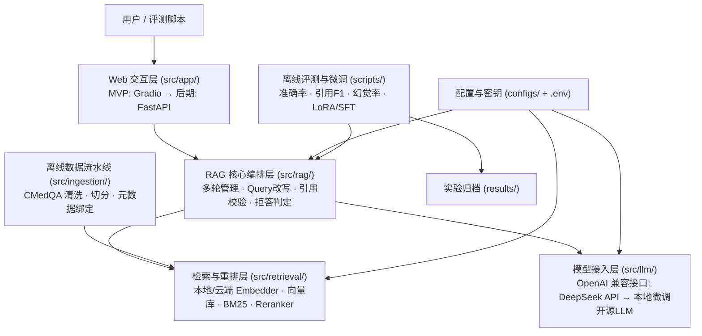

# 系统架构与概要设计（Design）

> 本文档明确整体架构方向、模块职责划分、核心流转与非功能设计，不涉及具体代码实现；跨模块接口细节在开发过程中动态沉淀至 [contracts/](contracts/README.md)。

---

## 1. 整体架构图

---

## 2. 模块职责划分

| 模块目录 | 核心职责 | 演进方向 |
| :--- | :--- | :--- |
| `src/ingestion/` | CMedQA 原始数据加载、去重去噪、文本分块、元数据绑定，以及知识库/评测集防泄漏划分 | MVP 支持 5k–20k 快速建库，后期扩展全量或补充医疗知识文档 |
| `src/retrieval/` | 文本向量化（Embedder）、向量索引构建与检索、稀疏检索（BM25）与重排（Reranker） | V0 单路本地语义检索 → V2 混合检索 + 重排 + Embedding 对比 |
| `src/llm/` | 封装统一的大模型对话接口、Token 预算检查、重试与异常处理 | V0 接入 DeepSeek 云端 API → V3 配置化切换本地开源/LoRA 微调服务 |
| `src/rag/` | 编排完整问答链路：多轮历史管理、Query 改写、上下文拼装、拒答阈值判定、引用映射校验与医疗免责声明 | V0 跑通基础链路 → V1 强化 Query 改写、>32k 窗口管理与引用/拒答精度 |
| `src/app/` | 提供人机交互界面与 HTTP 服务入口，仅作薄封装调用 `RAGService` | V0 轻量 `Gradio` → V4 升级 `FastAPI`（REST + SSE 流式 + 前端页面） |
| `scripts/` | 提供一键可复现入口：数据准备、自动化评测、长上下文压测、LoRA 微调、Demo 启动 | 覆盖课程要求的 5 类可复现脚本 |

---

## 3. 关键业务流程

### 3.1 离线数据构建流程
1. 读取原始 CMedQA 数据并完成基础清洗（空值、极短无效回复、重复项过滤）。
2. 按无泄漏原则切分出：**知识库语料**、**领域评测集**、**无答案/域外拒答测试集**。
3. 对知识库语料进行分块并附加溯源元数据（文档 ID、切块 ID、来源、原始问题）。
4. 使用配置的 Embedder 生成向量并持久化到本地向量库（V2 同步构建 BM25 索引）。

### 3.2 在线多轮问答流程
1. 接收当前用户提问与会话历史。
2. *(V1+)* 结合历史对话执行 Query 改写（补全省略实体与指代消解）。
3. 检索 Top-K 相关医疗文档片段（V2 引入混合检索与 Reranker 重排）。
4. **拒答前置判定**：若最高相关性分数低于设定阈值，直接触发安全拒答并返回说明，避免模型强行编造。
5. 按 `>32k` 上下文预算拼装系统提示词、历史摘要与带编号 `[1]..[K]` 的证据片段，调用 `LLMClient` 生成回答。
6. **后置校验**：核对回答中出现的引用编号均存在于当次召回列表，附加对应原文溯源卡片与医疗免责声明，返回结构化响应。

### 3.3 离线评测与迭代对比流程
1. 固定读取同一份领域评测集与拒答测试集。
2. 批量调用 `RAGService` 获取预测回答、引用编号与拒答标志。
3. 计算核心指标（准确率、引用 F1、幻觉率）与辅助指标（召回率、拒答率、延迟）。
4. 将版本号、配置快照与指标明细归档至 `results/`，用于跨版本对比制表与绘图。

---

## 4. 核心概念数据模型

> 具体字段类型与数据结构在开发时沉淀到 `docs/contracts/`。

- **KnowledgeChunk（知识块）**：唯一 `chunk_id`、所属 `doc_id`、文本正文、来源与科室等元信息。
- **RetrievedEvidence（召回证据）**：关联的 `KnowledgeChunk`、相关性/重排分数、展示序号（`1..K`）。
- **ChatTurn（对话轮次）**：角色（用户/助手）、内容、时间戳或轮次号。
- **RAGResponse（问答响应）**：回答正文、引用来源列表、是否触发拒答、Token 消耗与响应耗时、可选调试信息。

---

## 5. 非功能与可演进设计

1. **配置驱动与低耦合**：模型地址、Embedding 类型、检索策略、Top-K、拒答阈值与 Prompt 均集中管理于 `configs/config.yaml`，密钥统一通过 `.env` 注入。
2. **长上下文可靠性（>32k tokens）**：对话历史与检索证据采用分级预算截断策略，优先保留高分证据与近期轮次，防止超出上下文窗口导致静默截断或请求失败。
3. **可复现与团队一致性**：固定随机种子与评测集划分，默认本地轻量 Embedding 确保所有成员零额度限制、结果一致。
4. **医疗安全护栏**：任何版本均强制保留医疗免责声明与「无依据即拒答」策略。
